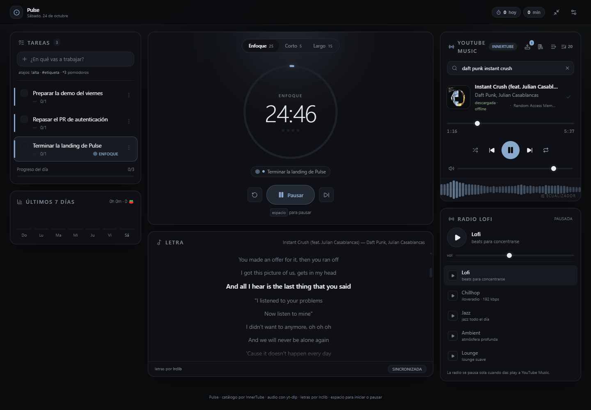

# Pulse — focus and music

Desktop app (Tauri v2) for working with music: tasks, pomodoro, lofi radio and
YouTube Music with synced lyrics, all in a single window. It also keeps songs on
disk for offline listening, shrinks into an always-on-top mini player and updates
itself from GitHub Releases. The interface is in Spanish.



Website: <https://zbrau.github.io/pulse/>

Windows 10/11 x64. Download the latest installer from
[GitHub Releases](https://github.com/zbrau/pulse/releases/latest).

## What it does

- **Tasks** — priority (high/medium/low), tags, pomodoro estimates, drag to
  reorder, and a per-task menu to rename, duplicate or delete. Add tasks with
  shortcuts (`!alta`, `#tag`, `*3`) and every completed pomodoro adds a point to
  the active task (`2/4`).
- **Pomodoro** — focus/break cycles, configurable long break, manual skips,
  chime and notification when a session ends, `space` to start or pause.
- **Lofi radio** — 5 live stations (Lofi, Chillhop, Jazz, Ambient, Lounge).
- **YouTube Music** — search any song, play it with a queue, shuffle, repeat,
  volume and a progress bar with real seeking.
- **Saved playlists** — anything you import stays on your machine and can be
  played, queued, renamed or deleted without pasting the link again.
- **Visualizer and equalizer** — real-time bars driven by the actual spectrum and
  a 5-band EQ with presets (Flat, Bass, Vocal, Rock, Electronic, Night).
- **Artist profiles** — photo, monthly listeners, biography, top songs, albums,
  singles and related artists; everything is browsable and playable.
- **Spotify import** — paste a public playlist link or upload an Exportify CSV:
  Pulse matches each song on YouTube Music and queues it.
- **Lyrics** — line-by-line synced to the exact second of the song (via
  [lrclib](https://lrclib.net)), or manual search when nothing is playing.
- **Stats** — pomodoros and focus minutes for the day, day streak and the last
  7 days.
- **Offline downloads** — keep songs on disk with a configurable quality (best,
  160, 128 or 96 kbps) and manage the storage from one dialog.
- **Mini mode** — the same window, resized and pinned on top, with the timer, the
  active task and the music controls.
- **Automatic updates** — the app checks GitHub Releases in the background,
  verifies the signature and installs the new version from Settings.

All data (tasks, sessions, settings, saved playlists and EQ) lives in the
WebView's `localStorage`, and downloaded audio lives in the app data folder:
nothing leaves your machine except YouTube Music searches and lyric lookups on
lrclib.

## How the music works

Pulse does not use the official YouTube API: the catalog comes from
**InnerTube** (YouTube Music's internal API) and the audio is resolved locally by
**yt-dlp**.

```
UI (React)  --invoke-->  Rust
                          |- innertube.rs   search + metadata
                          |- ytdlp.rs       audio URL (sidecar, cached)
                          |- lyrics.rs      lrclib (LRC) + parser
                          '- proxy.rs       127.0.0.1:<port> with Range
                                   ^
                          <audio src="http://127.0.0.1:.../stream/<id>">
```

- **Why a proxy**: the WebView `<audio>` element cannot read `googlevideo`
  directly (CORS and the `Range` requests needed for seeking). Rust requests the
  range from Google, forwards it, and if the URL expired (`403/410`) resolves it
  again with yt-dlp without the UI noticing.
- **Why yt-dlp**: InnerTube without a session no longer returns streams
  (PoToken/bot check), so the binary ships bundled as a *sidecar*.
- **Ephemeral port** on `127.0.0.1`: it exposes nothing outside the machine and
  does not collide with other processes.

## Artist profiles

Search returns artists as well as songs. Clicking one, or the artist name under
any song, opens its YouTube Music profile: photo, monthly listeners, subscribers,
biography, top songs, albums, singles and related artists. From there you can
play everything, add tracks to the queue or open an album and play it whole.

## Importing a Spotify playlist

Neither path needs a Spotify account or API:

1. **Public link** — paste `https://open.spotify.com/playlist/...` into the
   import button (the list icon next to the queue). Pulse reads Spotify's public
   *embed* page, which includes up to 100 songs.
2. **File** — export the list with [Exportify](https://exportify.net) and upload
   the `.csv` (or its `.json`). This is the way to import private or long
   playlists.

Each song is searched on YouTube Music and scored by title, artist and duration.
The dialog shows how many were found and which ones were not, and lets you play
them or add them to the queue.

## Saved playlists

With "Save to My playlists" enabled (the default), Pulse keeps the matched songs
— metadata only: title, artist, cover, album and duration — in a local library.
The library button in the player opens **My playlists**: play, add to the queue,
inspect the songs, rename or delete. They are still there after reopening the
app; audio is resolved with yt-dlp on play, just like any search.

Re-importing the same link or file updates the list instead of duplicating it: it
is identified by origin (normalized link or CSV filename), not by title.

## Visualizer and equalizer

The strip at the bottom of the player draws the real spectrum of what is playing.
Clicking it opens the 5-band **equalizer** (60 Hz, 230 Hz, 910 Hz, 3.6 kHz and
14 kHz; +/-12 dB) with quick presets and a response curve. This is real Web Audio:
the `<audio>` element goes through five biquads and an analyser before the output,
so the visualizer and the EQ share the same signal.

Settings are stored on your machine. The EQ only affects YouTube Music; lofi radio
has its own volume control.

## Offline downloads

Every search result and the current track have a download button. The file is
fetched by the bundled `yt-dlp`, saved under the app data folder
(`%APPDATA%\com.pulse.desktop\downloads`) and named after the video id, next to a
small JSON with its metadata.

- **Quality** — four presets that map to yt-dlp format selectors: *Best* (the best
  original audio), *High* (up to 160 kbps), *Medium* (up to 128) and *Low* (up to
  96). There is no ffmpeg in the bundle, so nothing is re-encoded: Pulse picks the
  best original track that fits the cap.
- **Storage manager** — the download icon in the player opens a dialog with the
  songs, their size, the total, the free disk space, the folder path, a delete
  action and a shortcut to open the folder in Explorer.
- **Offline first** — `resolve_stream` checks the disk before asking yt-dlp, and
  the local proxy serves the file at `/offline/<id>` with `Range` support. The
  player, the equalizer and the visualizer keep working exactly as they do online.
- **One at a time per song** — a download in progress is tracked so the same track
  cannot be queued twice; progress arrives through `download-progress` events.

Deleting a song that is currently playing unloads it from the player first, so
Windows lets the file go.

## Mini mode

The button next to Settings turns the main window into a compact player: about
430x200, not resizable and always on top of other windows.

This is not a second window. The React tree stays mounted and the full layout is
only hidden, so the radio, the queue, the position in the song and the timer keep
their state. The previous window size is captured before shrinking and restored on
exit, together with the minimum size and the always-on-top flag.

## Updates

Pulse uses `tauri-plugin-updater` with a minisign key pair. The public key is in
`tauri.conf.json`; the private key never enters the repository.

- The app checks `https://github.com/zbrau/pulse/releases/latest/download/latest.json`
  five seconds after start (silently) and whenever you press *Search* in Settings →
  *Engine*.
- When a version is available the top bar shows a badge, and the panel lists the
  release notes, the download progress and an *Install and restart* button.
- The update package is verified against the embedded public key before it is
  installed; a tampered file is rejected.
- Releases are built by `.github/workflows/release.yml` on tags `v*` with
  `tauri-action`, which uploads the installer, its signature and the
  `latest.json` manifest.

To build and sign a release locally:

```bash
export TAURI_SIGNING_PRIVATE_KEY="$(cat /path/to/pulse.key)"
export TAURI_SIGNING_PRIVATE_KEY_PASSWORD="..."
npm run tauri:build
```

The updater artifacts land in `src-tauri/target/release/bundle/nsis/`.

## Running it

Requirements: Node 20+, Rust 1.77+ and (on Windows) the WebView2 runtime, which
ships with Windows 11.

```bash
npm install
npm run desktop      # tauri dev
```

To build the installer:

```bash
npm run tauri:build
```

The output is written to:

```
src-tauri/target/release/pulse.exe
src-tauri/target/release/bundle/nsis/Pulse_0.2.0_x64-setup.exe
```

`npm run dev` only starts the web frontend (useful for UI work, without catalog or
audio).

The Windows bundles are produced with the GNU toolchain on this machine; CI uses
the default MSVC toolchain. The bundled `yt-dlp.exe` sidecar is committed under
`src-tauri/binaries/`, so a fresh clone can play audio without extra downloads.

## Tests

```bash
npm run typecheck    # TypeScript in strict mode
npm run build        # production frontend bundle
```

The app was verified end to end in the real window (dev and release): search with
20 results, audio advancing with real seeking, synced lyrics, artist profiles with
albums and playback, and Spotify playlist import by link (50 of 50 matched) and by
CSV (3 of 3). The library was tested by saving, renaming, playing, deleting and
surviving a reload; the visualizer was checked by measuring canvas energy (6x
while playing) and the EQ by confirming the audio graph runs with the applied
gains. The tasks system was covered with an end-to-end run: quick-add parsing,
priority grouping, editor actions, drag and drop, tag filtering, persistence and
the v1-to-v2 migration. The installer was extracted with 7-Zip and launched from
there to confirm it finds the bundled `yt-dlp`.

The 0.2.0 release binary was driven over the WebView2 DevTools protocol with
Playwright:

- a download created a 5.4 MB file with progress events, the result list switched
  to *Downloaded* and the storage manager showed size, folder, free space and the
  quality presets;
- `/offline/<id>` answered `200` with `audio/mp4` and `206` for
  `Range: bytes=100-199` with `Content-Range: bytes 100-199/...`;
- the track played from disk (`descargada · offline`) with the visualizer drawing
  real bars, and deleting it from the manager released the file and emptied the
  list;
- the *Low* preset produced a 2.1 MB file instead of 5.4 MB for the same song, and
  the choice survived a restart;
- mini mode resized the OS window to 430x200, set `WS_EX_TOPMOST` (checked with
  `GetWindowLong`), kept the current track and timer, and restored the exact
  previous size on exit;
- the update check failed cleanly with a Spanish message while no `latest.json`
  was published.

> `cargo test` does not start on this machine with the GNU + WebView2 toolchain:
> the test binary dies with `STATUS_ENTRYPOINT_NOT_FOUND` (a limitation of the
> combination, not of the code). The `lyrics.rs` tests stay in the repo and
> compile; the app and the installer work normally.

## Settings

The gear in the top bar opens four tabs:

- **Focus** — session durations, break chain, sound on finish.
- **Engine** — real status of InnerTube, yt-dlp and the local proxy, plus the
  update panel.
- **Downloads** — quality preset, number of songs, total size, free disk space and
  a shortcut to the storage manager.
- **Data** — export the state to JSON, reset stats or wipe everything. Export and
  wipe cover every `pulse-*` key, including the saved playlists and the EQ.

## Structure

```
src/                            frontend
├── App.tsx                     3-column layout
├── components/
│   ├── PomodoroCard.tsx        ring, modes, controls
│   ├── TasksPanel.tsx          task list
│   ├── FreePlayerCard.tsx      search, player and queue
│   ├── ArtistDialog.tsx        artist profile and albums
│   ├── PlaylistImportDialog.tsx Spotify import
│   ├── LibraryDialog.tsx       saved playlists
│   ├── EqualizerDialog.tsx     5-band EQ and presets
│   ├── DownloadsDialog.tsx     offline storage manager
│   ├── MiniPlayer.tsx          compact always-on-top layout
│   ├── UpdatePanel.tsx         update check and install
│   ├── Visualizer.tsx          animated spectrum (canvas)
│   ├── LyricsCard.tsx          synced lyrics + manual search
│   ├── LofiCard.tsx            radio (<audio> element)
│   ├── WeekStrip.tsx           last 7 days
│   ├── TopBar.tsx              date, daily stats, streak, mini mode
│   └── SettingsDialog.tsx      focus, engine, downloads and data
├── lib/music.ts                invoke bridge: search and streams
├── lib/downloads.ts            invoke bridge: offline downloads
├── lib/updater.ts              update check and signed install
├── lib/window.ts               mini-mode window sizing
├── lib/desktop.ts              Tauri detection helpers
├── lib/importTracks.ts         playlist CSV/JSON parser
├── lib/audioGraph.ts           Web Audio graph (EQ + analyser)
├── lib/lyrics.ts               invoke bridge: lyrics
├── lib/tasks.ts                task priorities, ordering and movement
├── lib/taskInput.ts            quick-add parser (!alta #tag *3)
├── lib/storage.ts              one-time storage-key migration
├── store/useStore.ts           persisted state (zustand)
├── store/usePlayerStore.ts     global player (single <audio>)
├── store/useDownloads.ts       download queue, progress and storage
├── store/useUpdater.ts         update state machine
├── store/useLibrary.ts         playlist library (localStorage)
├── store/useAudioFx.ts         equalizer settings (localStorage)
└── hooks/useTimerEngine.ts     pomodoro engine

src-tauri/                      backend
├── src/innertube.rs            search, artists and albums (WEB_REMIX)
├── src/spotify.rs              playlist import and matching
├── src/ytdlp.rs                audio resolution + cache
├── src/downloads.rs            yt-dlp downloads and metadata
├── src/lyrics.rs               lrclib, scoring and LRC parser
├── src/proxy.rs                Range proxy, /stream and /offline
├── src/lib.rs                  commands and proxy startup
└── binaries/yt-dlp.exe         bundled sidecar

docs/                           static landing page (GitHub Pages)
.github/workflows/release.yml   tag-driven release with updater artifacts
```

## Technical details

- **Drift-free timer**: it stores `endsAt` (epoch) instead of subtracting seconds,
  so time does not drift when the window loses focus. Reopening continues where it
  left off.
- **Single audio source**: playing YouTube Music pauses the radio and vice versa.
- **Single Web Audio graph**: `lib/audioGraph.ts` creates
  `source -> 5 biquads -> analyser -> destination` once. The proxy answers with
  `Access-Control-Allow-Origin: *` and exposes `Content-Range` so the
  `<audio crossOrigin="anonymous">` element does not taint the graph. If Web Audio
  fails, audio still plays through the normal output and the visualizer stays idle.
- **Real equalizer**: 5 biquads (lowshelf + 3 peaking + highshelf) with short ramps
  to avoid clicks when moving a slider; the analyser sits after the filters, so the
  visualizer reflects the equalized sound.
- **Offline audio through the same graph**: downloaded files are served by the
  same local proxy as streams (`/offline/<id>`), with `Range`,
  `Accept-Ranges`, `Content-Range` and CORS, so the Web Audio graph and the
  visualizer do not care where the bytes come from. `resolve_stream` returns
  `{ url, mimeType, expiresAt, offline }` and prefers the disk.
- **Mini mode without a second window**: `lib/window.ts` stores the physical size,
  sets `resizable=false`, a 380x168 minimum and a 430x200 logical size, pins the
  window with `setAlwaysOnTop(true)` and restores everything on exit. Only the
  layout is hidden, so all React state survives.
- **Download progress without ffmpeg**: yt-dlp runs with a custom
  `--progress-template` and `--newline`; Rust parses the percentages, throttles
  events to about 1% or 320 ms and emits `download-progress`, `download-done` and
  `download-error`.
- **Metadata as the source of truth**: each download is a media file plus a
  `<id>.json`. The listing rebuilds sizes from the file system, so a manually
  deleted file disappears from the dialog and a media file without JSON is
  repaired on the next download.
- **Signed updates**: the updater embeds a minisign public key and points at
  `releases/latest/download/latest.json`. The private key and its password live
  outside the repository and are provided to the build as environment variables.
- **Tasks v2 without data loss**: the task store is persisted at `version: 2` and
  the migration fills `priority: 'media'` and `tags: []` for old tasks. The visible
  order derives from the array with a stable sort by priority, so reordering needs
  no extra field and dropping a task in another group changes its priority.
- **Renamed storage, kept data**: the rebrand moved the keys from `sonora-*` to
  `pulse-*`, with a one-time copy that only runs when the new key does not exist
  yet.
- **WebView2 autoplay**: after resolving the stream, playback starts muted and the
  volume is restored on the first `playing` event, because the WebView blocks
  deferred play.
- **Lyrics**: lookup by artist + title + duration on lrclib, score the match and
  prefer the one with LRC. InnerTube is queried in parallel but without a session
  it no longer returns lyrics.
- **Audio resolution**: one yt-dlp call per song; the URL is cached until about one
  minute before its googlevideo `expire`.
- **Spotify without an API**: Pulse reads the HTML of
  `open.spotify.com/embed/playlist/...`, which contains the list in
  `__NEXT_DATA__`. The old `get_access_token` endpoint returns `403`, so it is not
  used.
- **Matching**: every imported song triggers 3 parallel searches and is scored by
  title, artist and duration; below the threshold it retries once with the title
  only. Progress arrives through the `import-progress` event.
- **InnerTube key**: requests use YouTube's public web client key, the same one the
  web player sends; there is no account, OAuth token or personal credential
  involved.

## Troubleshooting

| Symptom | Cause |
| --- | --- |
| Search returns nothing | No network, or InnerTube changed its format: check the **Engine** tab. |
| "yt-dlp failed" when pressing play | The video has no audio available or changed region. Try another song. |
| Lyrics say "No lyrics available" | lrclib does not have that song. Use manual search. |
| Audio does not start | Another player took over the output device; pause and press play again. |
| Import says "playlist not found" | It is private or no longer exists; export the CSV with Exportify and upload it. |
| Some imported songs are missing | They are not on YouTube Music or have a different title there; search for them manually. |
| The artist profile is empty | YouTube changed the page format: check the **Engine** tab and update Pulse. |
| A download stays at 0% | No network, or yt-dlp cannot reach YouTube: check the **Engine** tab. |
| A download says it failed | The video is age-restricted, region-locked or has no audio stream. Try another song. |
| Deleting a song fails | It is still open in the player or another program; pause it and try again. |
| The update check fails | GitHub is unreachable, or the release has no `latest.json` yet. The app keeps working. |
| Mini mode is not on top | A fullscreen app can hide it; exit fullscreen or press the restore button. |

## Roadmap

- Likes and user-created playlists inside Pulse.
- Reorder or remove songs from a saved playlist.
- Retry failed imports by picking the correct match.
- Per-task history and hours-by-project charts.
- Soft due dates (today / tomorrow) and archive with undo.
- Keyboard shortcuts (`n` for a new task, `1/2/3` for timer modes, `p` for
  play/pause).

## License

MIT — see [LICENSE](LICENSE).
